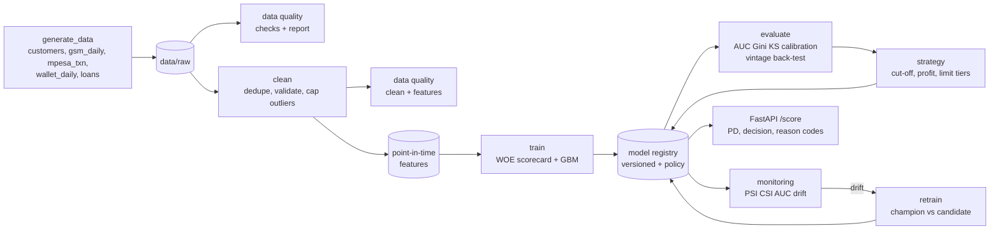
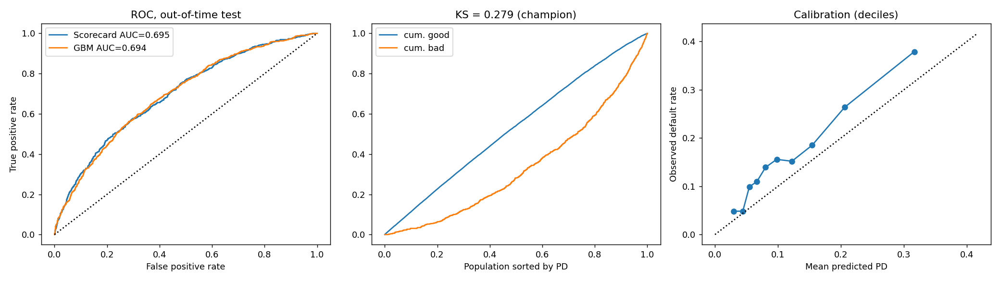
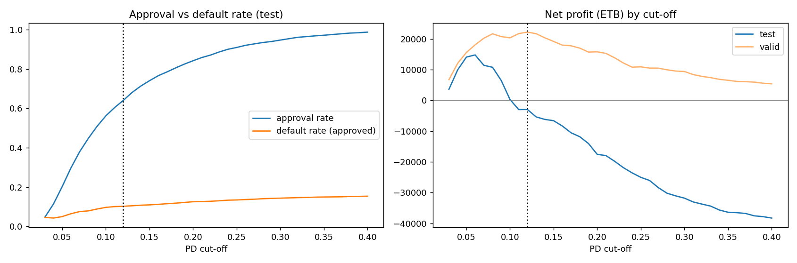
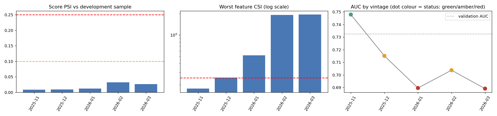

# telco-credit-scoring

An end-to-end, reproducible **mobile credit-scoring pipeline** for a telco lender: GSM + mobile-money data, point-in-time
feature engineering, an explainable scorecard and a gradient-boosting challenger, out-of-time validation, cut-off and
credit-limit strategy, drift monitoring with automated retraining, and a scoring API.

> **Everything here runs on synthetic data.** Real GSM / M-PESA / repayment data is private, so a generator simulates it.
> Absolute numbers say nothing about a real operator; the point is the engineering and modelling method.

**Origin.** This project is built on top of an Apache-2.0 open-source starter, *Alternative Credit Scoring using Synthetic
Telecom Data* (original README, notebook and CSV preserved unmodified in [`legacy_snapshot/`](legacy_snapshot/); see
[`NOTICE`](NOTICE)). The starter provided a flat 10,000-row snapshot and a latent-creditworthiness idea; this repo extends it
into time-stamped tables and a full ML lifecycle. See [What changed vs the original](#what-changed-vs-the-original).

## Architecture



## Quick start

```bash
pip install -r requirements.txt            # or requirements-core.txt (scikit-learn fallbacks, no extras)
make all                                    # generate -> ETL -> train -> evaluate -> strategy -> monitor -> retrain -> docs
make test                                   # 21 tests
make api                                    # http://localhost:8000/docs   (or: make docker)
```

Optional engines are used automatically when installed and replaced by scikit-learn fallbacks otherwise:
LightGBM (GBM), SHAP (explanations), DuckDB (SQL feature engine), MLflow (experiment tracking).

```bash
curl -X POST localhost:8000/score -H 'content-type: application/json' \
  -d '{"customer_id":"C000042","features":{"topup_cnt_30d":2,"sms_cnt_30d":40,"mp_inflow_30d":3500,"loan_amount":200}}'
# -> {"pd":0.18,"decision":"DECLINE","scorecard_points":..., "reason_codes":[{"feature":"sms_cnt_30d","points_lost":..,"reason":"SMS sent in the last 30 days"},..], ...}
```
Missing features are scored as missing (own WOE bin / native NaN handling), so partial payloads still work.

## The data (synthetic)

| Table | Grain | Content |
|---|---|---|
| `customers` | subscriber | region, device type, tenure |
| `gsm_daily` | customer-day | airtime top-ups, voice, data, SMS |
| `mpesa_txn` | transaction | cash-in/out, P2P, bill pay, merchant, salary credits |
| `wallet_daily` | customer-day | end-of-day wallet balance |
| `loans` | loan | 15-day advance, fee, repayment date, **default = unpaid 30 days after disbursement** |

5,000 customers, 15 months, 19,400 loans, 12% default rate. Hidden drivers (stability, income, income volatility, top-up
irregularity, a persistent monthly "stress" state, prior late repayment, loan-to-income) drive default but are **never written
to disk**, and large unobserved noise keeps the achievable AUC realistic rather than trivial. Raw data contains deliberate defects
(duplicates, negative amounts, 100x outliers, null regions) so the data-quality layer has real work. A shock (airtime promo +
delayed inflows + macro stress) starts in 2026-01 so monitoring has real drift to find. Full schema: [`docs/data_dictionary.md`](docs/data_dictionary.md).

## What is in the pipeline

| Stage | Module | What it does |
|---|---|---|
| Data generation | `src/generate_data.py` | Time-stamped, linked tables; default rate calibrated by bisection; optional shock |
| ETL | `src/etl.py` | raw -> clean -> features layers; every cleaning rule logged with rows affected |
| Data quality | `src/data_quality.py` | 60+ Great-Expectations-style checks: schema drift, nulls, duplicates, ranges, referential integrity, outliers, date order, completeness. JSON + Markdown reports |
| Features | `src/features.py`, `sql/features_core.sql` | 46 features: rolling 7/30/90-day top-up, usage and wallet behaviour, income volatility, inflow/outflow ratio, days since last activity, prior-loan history. Pandas/NumPy engine plus a DuckDB SQL version (parity-tested) |
| Scorecard | `src/scorecard.py` | WOE/IV binning, IV + correlation + coefficient-sign selection, logistic regression, points scaling (600 @ 20:1, PDO 50), per-applicant reason codes |
| Challenger | `src/gbm.py` | LightGBM (or sklearn HistGBM) with early stopping and Platt calibration |
| Evaluation | `src/evaluate.py` | AUC, Gini, KS, Brier, calibration and decile tables, per-vintage back-test, ROC/KS/calibration plots |
| Strategy | `src/strategy.py` | Cut-off sweep (approval vs default vs expected loss vs profit), limit tiers; cut-off chosen on validation, judged on test |
| Monitoring | `src/monitoring.py` | Score PSI, feature CSI, AUC drift, approval/default trends by vintage; GREEN/AMBER/RED |
| Retraining | `src/retrain.py` | Monitor -> retrain on matured loans -> champion/challenger -> promote; monthly GitHub Action |
| Registry / serving | `src/registry.py`, `src/serving.py`, `api/app.py` | Versioned bundles + policy, optional MLflow logging, FastAPI service, Dockerfile |
| Docs | `docs/` | Model card, feature catalog (with IV), data dictionary (generated from the latest run) |

## Results (reference run, seed 42)

Split by **disbursement date**, never randomly: train to 2025-10, validation to 2025-12, **out-of-time test 2026-01 to 2026-03** (the shock window).

| Model | Split | AUC | Gini | KS |
|---|---|---|---|---|
| WOE scorecard (**champion**) | validation | 0.733 | 0.465 | 0.364 |
| WOE scorecard (**champion**) | out-of-time test | 0.695 | 0.390 | 0.279 |
| GBM challenger | validation / test | 0.731 / 0.694 | 0.462 / 0.387 | 0.351 / 0.282 |

The GBM does not beat the scorecard by the required 0.01 AUC, so the explainable scorecard is the champion. This is a realistic
outcome on behavioural data of this kind, and a reason to prefer the scorecard where adverse-action explanations are required.
The reference run used scikit-learn's HistGBM fallback; LightGBM will differ slightly.



### Business framing: cut-off and limits ([`reports/strategy.md`](reports/strategy.md))

Economics: fee on repaid loans, 85% LGD on defaults, 1% cost of funds. On the out-of-time test set:

| Policy | Approval | Default rate (approved) | Net profit (ETB) |
|---|---|---|---|
| Approve all | 100% | 15.8% | -40,954 |
| PD <= 0.12 (cut-off chosen on validation) | 64% | 10.2% | -2,946 |
| PD <= 0.09 (tighter) | 51% | 8.9% | +6,468 |

Two honest takeaways: the model cuts the default rate among approved loans from 15.8% to 10.2% and improves profit by about 38k ETB on
the same loans; **and** the cut-off tuned on pre-shock validation data is already too loose once the shock arrives, which is exactly why
monitoring and re-tuning the policy matter. Tiered limits (x1.5 / x1.0 / x0.6 by risk) improve profit further on the same loans.



### Monitoring and drift ([`reports/monitoring_report.md`](reports/monitoring_report.md))

The simulated shock first shows up as **feature drift** (`topup_avg_amt_30d` CSI 0.5 in January, 1.9 from February), then as AUC
falling from 0.733 on validation to 0.69, which flags the vintage RED and recommends retraining. The overall score PSI stays low
(< 0.05): offsetting feature shifts left the score distribution almost unchanged while ranking quality degraded. That is why the
rules look at feature CSI and performance, not only score PSI. `src.retrain` trains a candidate on all matured loans, compares it
with the live model on the shared recent window, promotes it (re-tuning the cut-off on that window) and logs the decision in
`reports/retrain_log.json`.



## Point-in-time correctness (no leakage)

Every feature window is `[snapshot - W, snapshot)`; prior-loan features use only loans whose outcome was known *before* the
snapshot. [`tests/test_point_in_time.py`](tests/test_point_in_time.py) proves it by (a) corrupting all activity on or after a
date and checking earlier loans' features do not move, (b) flipping a loan's own outcome and checking its features do not move, and
(c) hand-computed values on a tiny dataset. I also checked the tests have teeth: injecting a one-day look-ahead into the window
code makes them fail.

## What changed vs the original

| Original starter | This project |
|---|---|
| One flat snapshot table, no dates | Five linked, dated tables (GSM, M-PESA, wallet, loans, customers) |
| Label = no recharge within 15 days | Real repayment outcomes with due date, lateness and default at 30 days |
| No repayment history, no time dimension | Prior-loan features, vintages, out-of-time split, back-test, drift |
| Generator + README only | ETL, data quality, features, two models, strategy, monitoring, retraining, API, tests, CI, docs |
| 200-800 score from `1 - PD` | Kept (`credit_score_200_800` in the API) next to scorecard points with PDO scaling and reason codes |

For reference, a quick baseline on the original CSV (`python -m src.baseline_legacy`, random 70/30 split because it has no dates)
gives AUC 0.67 (logistic) / 0.59 (GBM). Run it to see the exact numbers in `reports/legacy_baseline.json`.

## Verification status

Verified in the build environment (Python 3.12, scikit-learn fallbacks): the full pipeline end to end, 19 tests (leakage, data
quality, generator rules, scorecard, metrics, train -> register -> serve). **Written but not executed there** because the sandbox
had no network: the DuckDB SQL engine (`tests/test_duckdb_parity.py`), the FastAPI app (`test_fastapi_endpoints`), the LightGBM,
SHAP and MLflow code paths, and the Docker build. CI (`.github/workflows/ci.yml`) installs everything and runs those on push; run
`make test` after `pip install -r requirements.txt` and tell me if anything fails.

## Limitations

Synthetic data; no reject inference; region and device type could proxy for protected attributes; wallet balances are floored
at zero and only approximately consistent with transactions; one product and one 30-day default definition. See
[`docs/model_card.md`](docs/model_card.md).

## License
Apache-2.0 (see [`LICENSE`](LICENSE) and [`NOTICE`](NOTICE)).
